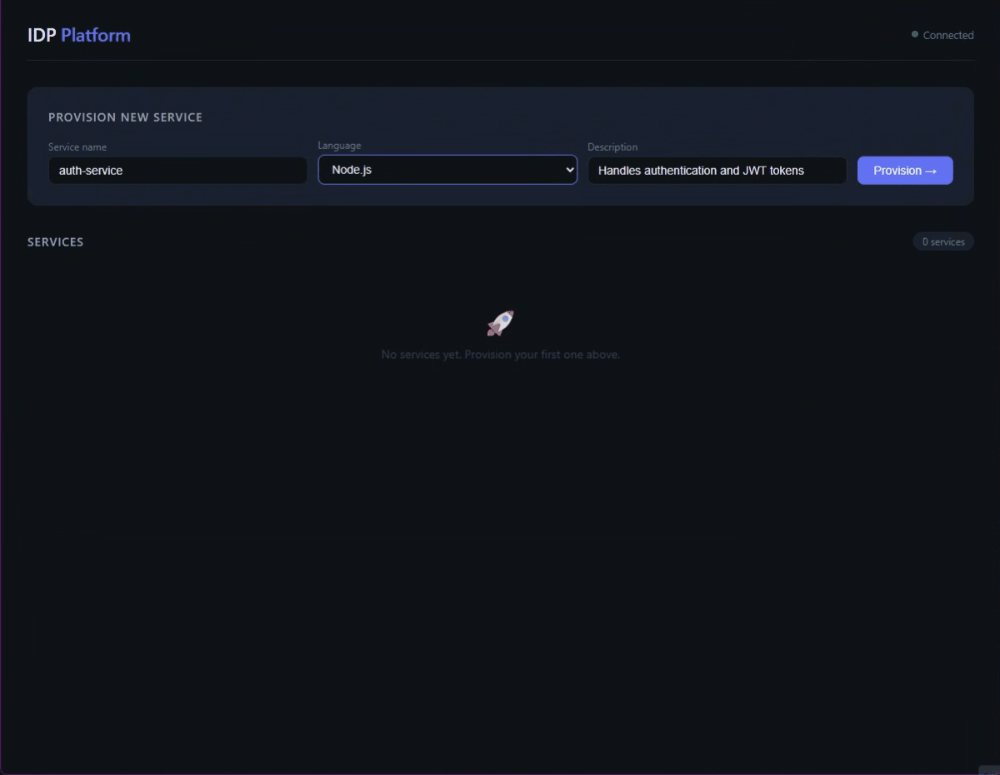

# IDP Platform — Internal Developer Platform

> A self-service platform that lets developers provision fully configured 
> microservices from a web form or a single API call — GitHub repo, Dockerfile, 
> CI, Kubernetes deployment, all created automatically, with each step 
> streamed live to the browser.

## Demo



## What it does

POST one request to `/api/services` and the platform automatically:

1. Creates a GitHub repository with the correct structure
2. Adds a Dockerfile and GitHub Actions CI pipeline
3. Deploys the service to Kubernetes (Deployment + Service + Ingress)
4. Streams real-time provisioning status back via SignalR

## Frontend

`web/` is a Next.js + TypeScript app on top of the API:

- **Create service form** with client-side validation that matches what the 
  backend needs (the name becomes a Kubernetes namespace, so it must be a 
  valid DNS label). Errors are tied to fields with `aria-describedby`, and 
  focus moves to the first problem on submit. Server validation errors are 
  mapped back onto the right field.
- **Live provisioning view**: repo → Dockerfile → CI → README → Kubernetes, 
  each step lighting up as `StatusChanged` events arrive over SignalR. A 
  failed run shows which step broke and the error, and that survives a 
  page reload (`FailedStep` is stored).
- **Services list** with status counts, updated live.

How the real-time part works:

- One SignalR connection for the whole app. Events are written straight into 
  the TanStack Query cache, so every view of a service updates.
- Events older than the cached data are ignored, so a late event can't roll 
  a service back to an earlier step.
- Reconnects retry forever with backoff. After reconnecting, the app 
  refetches, because events sent while it was disconnected are lost.
- While the connection is down, in-progress services fall back to polling 
  every 5 seconds, and the header badge shows the connection state.

Tests: Vitest + Testing Library for the logic and components (including the 
hub provider, driven by a fake connection), and Playwright for the full 
create flow. The Playwright tests mock the REST API and play the SignalR 
server over a mocked WebSocket, so CI needs no .NET, database or cluster.

## Why I built this

Most teams waste hours setting up the same boilerplate every time they 
start a new service, creating a repo, writing a Dockerfile, configuring 
CI, setting up Kubernetes manifests. This platform automates all of that 
with a single API call.

I built it to understand how internal developer platforms like Backstage 
work under the hood, and to demonstrate that complex developer tooling 
can be built with clean, maintainable .NET code.

## Tech stack

| Layer | Technology |
|---|---|
| Frontend | Next.js, React, TypeScript, TanStack Query, `@microsoft/signalr` |
| Frontend tests | Vitest, Testing Library, Playwright |
| API | ASP.NET Core 9 |
| Database | PostgreSQL + Entity Framework Core |
| GitHub automation | Octokit.net (GitHub REST API) |
| Kubernetes automation | KubernetesClient |
| Real-time updates | SignalR |
| Logging | Serilog (structured JSON logs) |
| API docs | Scalar |

## NuGet package

The GitHub provisioning module is available as a standalone NuGet package:
```bash
dotnet add package IdpPlatform.GitHub
```
```csharp
var provisioner = new GitHubProvisioner(new GitHubProvisionerOptions
{
    Token        = "your-github-token",
    Organisation = "your-github-username"
});

var result = await provisioner.CreateServiceRepoAsync(
    serviceName: "payments-api",
    language:    "dotnet",
    description: "Handles payment processing");

Console.WriteLine(result.RepoUrl);
```

## Running locally

**Prerequisites:** .NET 9, Docker Desktop
```bash
# 1. Start the database
docker run -d \
  --name idp-postgres \
  -e POSTGRES_USER=idpuser \
  -e POSTGRES_PASSWORD=idppass \
  -e POSTGRES_DB=idpdb \
  -p 5432:5432 \
  postgres:16

# 2. Run the API
dotnet run --project src/Idp.Api

# 3. Open API docs
# http://localhost:5107/scalar/v1

# 4. Run the frontend (in another terminal)
cd web
npm install
npm run dev
# http://localhost:3000
```

The frontend calls the API at `NEXT_PUBLIC_API_URL` (default 
`http://localhost:5107`, see `web/.env.example`). The API allows CORS from 
`http://localhost:3000` by default; set `Frontend:Origins` in 
`appsettings.json` to change that.

Frontend checks:
```bash
cd web
npm run lint       # typecheck
npm test           # Vitest
npm run test:e2e   # Playwright (builds the app, mocks the API)
```

## API endpoints

| Method | Endpoint | What it does |
|---|---|---|
| POST | `/api/services` | Provision a new service |
| — | `/hubs/provisioning` | SignalR hub, sends `StatusChanged` for each step |
| GET | `/api/services` | List all services |
| GET | `/api/services/{id}` | Check provisioning status |

## Project structure

IdpPlatform/
├── src/
│   ├── Idp.Api/             # ASP.NET Core API — entry point
│   ├── Idp.Core/            # Domain models + interfaces
│   ├── Idp.Infrastructure/  # Database, EF Core, external clients
│   └── Idp.Worker/          # Background provisioning pipeline
├── web/                     # Next.js frontend
│   ├── src/app/             # Routes: list, new service, live service view
│   ├── src/components/      # Form, pipeline steps, list, status badges
│   ├── src/lib/             # API client, SignalR provider, step logic, validation
│   └── e2e/                 # Playwright tests + mock API/SignalR server
└── README.md

## Status

| Task | Feature | Status |
|---|---|---|
| Task 1 | API skeleton + PostgreSQL + EF Core | ✅ Done |
| Task 2 | GitHub integration — auto repo + Dockerfile + CI | ✅ Done |
| Task 3 | Background worker + Kubernetes integration | ✅ Done |
| Task 4 | SignalR real-time status + dashboard UI | ✅ Done |
| CI/CD | GitHub Actions — build, test, Docker image push on every commit | ✅ Done |
| Task 5 | Next.js frontend — create form, live per-step provisioning view, tests | ✅ Done |